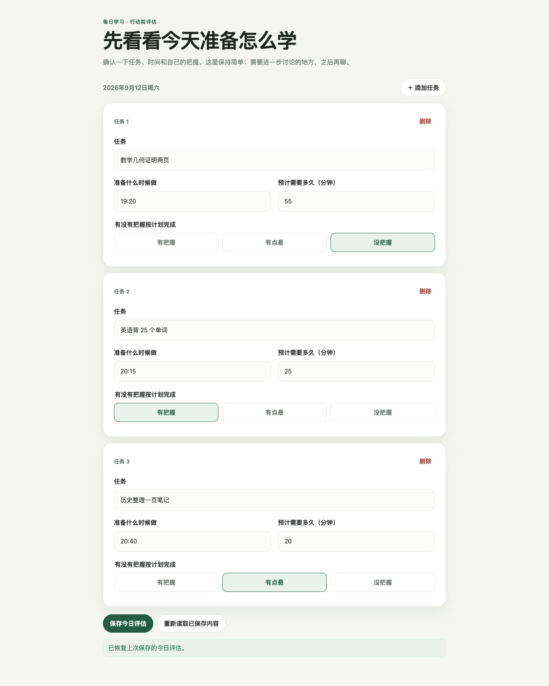
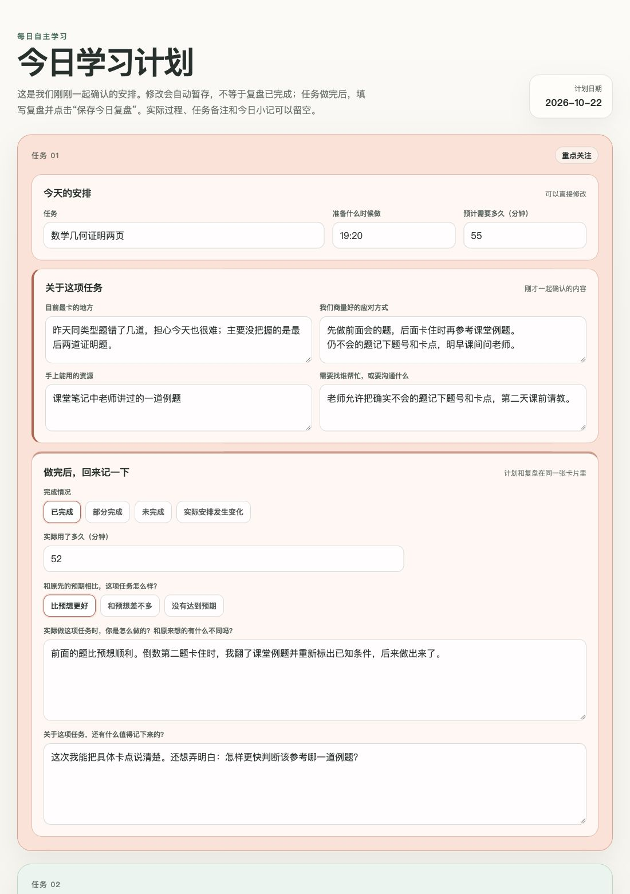

# 以起草之名｜每日学习计划与复盘 Skill

Name：**DC-Daily SRL Skill**


> 把每天零散的学习任务收拢起来，在充分引导下完成计划、执行、复盘与进一步讨论，并沉淀为一份可以回看的本地学习记录。

## 它最重要的价值

| | 你会获得什么 |
| --- | --- |
| **统一规整任务** | 把作业、复习、阅读和其他学习活动集中到当天的任务全景中，不再依靠零散提醒维持进度。 |
| **系统串联流程** | 将计划、执行、复盘和必要的进一步讨论连接起来，让一次学习从“准备做”走到“知道实际发生了什么”。 |
| **提升体验与掌控力** | 通过更清楚的安排、可修改的计划和真实的执行反馈，减少混乱感，逐渐掌握自己的学习节奏。 |
| **充分引导而不替代** | Agent 会一步步帮助你识别困难、考虑资源和形成办法；学习者始终可以补充、纠正、拒绝或调整。 |

> [!IMPORTANT]
> **如果你对“如何系统地提升学习能力”感兴趣，可以关注公众号「以起草之名」，了解基于“每日计划与复盘Skill”设计的「学习力发展计划」。**

## 页面效果


**Assessment（任务评估）**：先把今天要做的任务、时间、预计用时和把握程度放在一起。

[](docs/images/assessment-example.png)

**Daily Page（每日学习页）**：计划、讨论结果、实际执行和复盘留在同一张任务卡片中；实际过程与任务备注分别填写，也都可以留空。

[](docs/images/daily-page-example.jpg)

## 30 秒开始

### 如何触发这个 Skill

安装后，可以直接对 Agent 说：

```text
我想整理和安排一下今天的学习任务
```

也可以从更具体的情况开始：

```text
我今天要写一张数学卷子和订正语文试卷。
```

这些是进入当天流程的触发方式。完成计划、进入复盘或结束讨论时所说的话，属于后续阶段的推进动作，不是初始触发语。

## 它怎样完成一天的学习闭环

```text
任务盘点 → 轻量评估 → 逐项讨论 → 今日计划 → 实际执行
        → 执行记录与当日复盘 → 进一步讨论（按需） → 最终保存
```

这不是一个自动化程序。每个阶段都由学习者的填写、表达或确认推动，Agent 负责识别当前阶段并给出下一步引导。

### 学习者怎样推动流程

| 当前阶段 | 学习者要做什么 |
| --- | --- |
| **开始** | 告诉 Agent 今天有哪些学习任务，或者直接要求进入 Daily SRL 流程。 |
| **轻量评估** | 在 Assessment 页面确认每项任务、准备开始的时间、预计用时和把握程度，然后保存。 |
| **逐项讨论** | 根据引导说明具体困难、可用资源和自己的想法；可以纠正、拒绝或调整 Agent 提出的内容。 |
| **形成今日计划** | 确认讨论后的安排，并告诉 Agent 可以生成今天的计划页。 |
| **实际执行** | 按 Daily Page 开始学习；时间、顺序或任务有变化时，可以直接修改页面。 |
| **当日复盘** | 在同一页面填写完成情况、实际用时和与预期的差异，然后保存今日复盘。 |
| **进一步讨论** | 如果还有值得理解的差异、体验或问题，可以继续聊；也可以明确表示不需要继续讨论。 |
| **最终保存** | 确认没有其他想补充的内容，请 Agent 保存并结束当天流程。 |

## 最终会得到什么

- 一张清楚的当天学习任务全景；
- 一份经过讨论、仍然可以由自己修改的今日计划；
- 对计划与实际执行差异的记录和理解；
- 必要时，对困难、体验或发现进行一次更深入的讨论；
- 一份保存在本地的 `Learning Record（学习记录）`，留下当天从计划到复盘的完整脉络。

## 温馨提示

1.每天开启一个新对话，不要在同一个对话中开展连续多日的学习管理。

2.在学习过程中，Skill 可以提供有限的日常情绪支持，并根据学习者当下的状态调整节奏，但不能替代专业支持。

3.每天结束后，Skill 会在学习者选择的本地工作区生成一份 `Learning Record（学习记录）`。其中可以包含当天的任务评估、讨论后形成的计划、实际执行、复盘，以及按需产生的进一步讨论内容。

## 安装

### 方式一：直接发给 AI（推荐）

```text
帮我安装“以起草之名-每日计划与复盘”（DC-Daily SRL Skill）这个 Skill。请按下面步骤操作：

1. 确认当前 Agent 使用的技能目录，不存在就创建。
2. 从 https://github.com/tempetempe/temperance-daily-srl-skill 获取完整仓库，安装到技能目录下的 dc-daily-srl-skill 文件夹。
3. 验证文件夹内包含 SKILL.md、scripts/、templates/、references/，并保留 SKILL.md 中的原有中文名称。
4. 按当前 Agent 支持的方式加载技能，告诉我实际安装结果。之后我在新对话里说“我想整理和安排一下今天的学习任务”，就使用这个 Skill 开始当天流程。
```

### 方式二：命令行安装

在支持 `.agents/skills/` 的 Agent 项目目录中运行：

```sh
git clone --branch v7.1-name-update --depth 1 https://github.com/tempetempe/temperance-daily-srl-skill.git .agents/skills/dc-daily-srl-skill
```

## 当前版本

当前正式版本：**7.1.0**，发布于 2026-10-22。

## 许可

本项目采用 [PolyForm Noncommercial License 1.0.0](LICENSE)。

允许依照许可证进行非商业使用、研究、学习、修改和传播。商业使用、商业分发、集成到商业产品或以本项目提供收费服务，须事先获得版权主体的单独书面授权。

```text
Copyright © 2026 虫叔（Temperance）
```

许可证不授予对项目名称、作者身份或官方认可的权利。修改版本不得冒充官方版本，也不得暗示已经获得虫叔（Temperance）的认可。

## 免责声明

本项目按许可证中的“现状”条款提供，不附带任何明示或默示保证。它提供普通学习管理与有限的日常情绪支持，不替代教师、监护人、医疗人员、心理专业人员或当地紧急支持服务。
