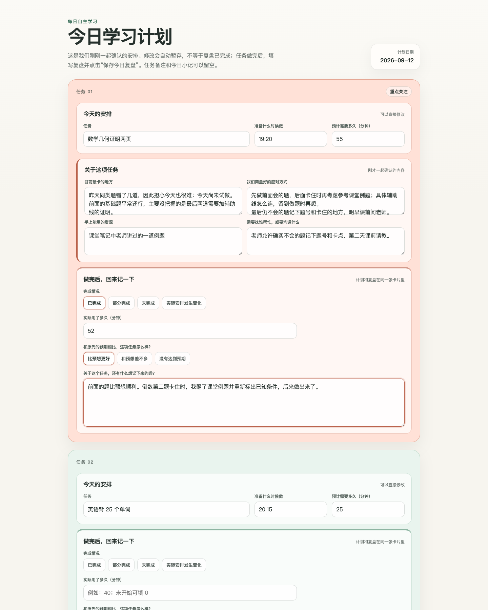

# 以起草之名｜每日学习计划与复盘 Skill


> 把每天零散的学习任务收拢起来，在充分引导下完成计划、执行、复盘与进一步讨论，并沉淀为一份可以回看的本地学习记录。

如果你对“如何系统地提升学习能力”感兴趣，可以关注公众号「以起草之名」，了解我们基于「每日计划与复盘（Daily SRL Skill）」设计的「学习力发展计划」。

## 它最重要的价值

| | 你会获得什么 |
| --- | --- |
| **统一规整任务** | 把作业、复习、阅读和其他学习活动集中到当天的任务全景中，不再依靠零散提醒维持进度。 |
| **系统串联流程** | 将计划、执行、复盘和必要的进一步讨论连接起来，让一次学习从“准备做”走到“知道实际发生了什么”。 |
| **提升体验与掌控力** | 通过更清楚的安排、可修改的计划和真实的执行反馈，减少混乱感，逐渐掌握自己的学习节奏。 |
| **充分引导而不替代** | Agent 会一步步帮助你识别困难、考虑资源和形成办法；学习者始终可以补充、纠正、拒绝或调整。 |

如果你也关心如何系统地提升学习能力，欢迎关注公众号「以起草之名」，了解我们基于「每日计划与复盘（Daily SRL Skill）」推出的「学习力发展计划」。

## 页面效果


**Assessment（任务评估）**：先把今天要做的任务、时间、预计用时和把握程度放在一起。

[](docs/images/assessment-example.png)

**Daily Page（每日学习页）**：计划、讨论结果、实际执行和复盘留在同一张任务卡片中。

[](docs/images/daily-page-example.png)

## 30 秒开始

### 如何触发这个 Skill

安装后，可以直接对 Agent 说：

```text
我想整理和安排一下今天的学习任务
```

也可以从更具体的情况开始：

```text
我今天要写一张数学卷子和订正语文试卷。
```

这些是进入当天流程的触发方式。完成计划、进入复盘或结束讨论时所说的话，属于后续阶段的推进动作，不是初始触发语。

## 它怎样完成一天的学习闭环

```text
任务盘点 → 轻量评估 → 逐项讨论 → 今日计划 → 实际执行
        → 执行记录与当日复盘 → 进一步讨论（按需） → 最终保存
```

这不是一个自动化程序。每个阶段都由学习者的填写、表达或确认推动，Agent 负责识别当前阶段并给出下一步引导。

### 学习者怎样推动流程

| 当前阶段 | 学习者要做什么 |
| --- | --- |
| **开始** | 告诉 Agent 今天有哪些学习任务，或者直接要求进入 Daily SRL 流程。 |
| **轻量评估** | 在 Assessment 页面确认每项任务、准备开始的时间、预计用时和把握程度，然后保存。 |
| **逐项讨论** | 根据引导说明具体困难、可用资源和自己的想法；可以纠正、拒绝或调整 Agent 提出的内容。 |
| **形成今日计划** | 确认讨论后的安排，并告诉 Agent 可以生成今天的计划页。 |
| **实际执行** | 按 Daily Page 开始学习；时间、顺序或任务有变化时，可以直接修改页面。 |
| **当日复盘** | 在同一页面填写完成情况、实际用时和与预期的差异，然后保存今日复盘。 |
| **进一步讨论** | 如果还有值得理解的差异、体验或问题，可以继续聊；也可以明确表示不需要继续讨论。 |
| **最终保存** | 确认没有其他想补充的内容，请 Agent 保存并结束当天流程。 |

## 最终会得到什么

- 一张清楚的当天学习任务全景；
- 一份经过讨论、仍然可以由自己修改的今日计划；
- 对计划与实际执行差异的记录和理解；
- 必要时，对困难、体验或发现进行一次更深入的讨论；
- 一份保存在本地的 `Learning Record（学习记录）`，留下当天从计划到复盘的完整脉络。

## 适合 / 不适合

**✅ 适合**：当天作业安排、考试复习、自主学习、阅读计划、任务很多或思路比较乱的时候，以及完成学习后的当日复盘。

在学习过程中，Skill 可以提供有限的日常情绪支持，并根据学习者当下的状态调整节奏，但不能替代专业支持。

## 安装

### 命令行安装

先安装 [Git](https://git-scm.com/downloads)。如果使用的 Agent 支持项目级 `.agents/skills/` 目录，在项目目录中打开终端，运行以下命令即可获取完整 Skill。Windows PowerShell 和 macOS 终端使用相同命令：

```sh
git clone --branch v6.0 --depth 1 https://github.com/tempetempe/temperance-daily-srl-skill.git .agents/skills/daily-srl-skill
```

此命令固定使用正式版 `v6.0`，将 `SKILL.md`、脚本、模板和参考资料一起放入 `.agents/skills/daily-srl-skill/`。如果 Agent 使用其他技能目录，请将命令最后的路径替换为该目录下的 `daily-srl-skill` 子目录。目标目录应尚不存在；已有旧版时，先按 Agent 的方式停用或移走旧版，再安装。

完成后，按所用 Agent 的规则刷新技能或开启新会话，选择保存学习资料的本地工作区，再使用上面的触发语开始。技能文件与学习工作区可以分别存放。

以上为通用安装方法，具体支持的技能目录与加载方式以所用 Agent 的说明为准。仓库公开后可直接通过上述命令获取，无需 GitHub 账号；仓库仍为 Private 时，需要具有访问权限的 GitHub 账号。

运行脚本使用 Python 标准库，不需要额外安装 Python 包。6.0 包含 Windows 与 Mac 的保存服务启动适配，以及平台原生文件锁。Mac 本机开发验证与 Windows 分支模拟分别记录；真实 WorkBuddy 的进程管理和浏览器恢复表现仍以实际使用为准。升级时保留完整学习工作区，避免同名旧版同时生效。

## 本地学习记录

每天结束后，Skill 会在学习者选择的本地工作区生成一份 `Learning Record（学习记录）`。其中可以包含当天的任务评估、讨论后形成的计划、实际执行、复盘，以及按需产生的进一步讨论内容。

## 当前版本

当前正式版本：**6.0**，更新发布于 2026-10-21。

## 许可

本项目采用 [PolyForm Noncommercial License 1.0.0](LICENSE)。

允许依照许可证进行非商业使用、研究、学习、修改和传播。商业使用、商业分发、集成到商业产品或以本项目提供收费服务，须事先获得版权主体的单独书面授权。

```text
Copyright © 2026 虫叔（Temperance）
```

许可证不授予对项目名称、作者身份或官方认可的权利。修改版本不得冒充官方版本，也不得暗示已经获得虫叔（Temperance）的认可。

## 免责声明

本项目按许可证中的“现状”条款提供，不附带任何明示或默示保证。它提供普通学习管理与有限的日常情绪支持，不替代教师、监护人、医疗人员、心理专业人员或当地紧急支持服务。
